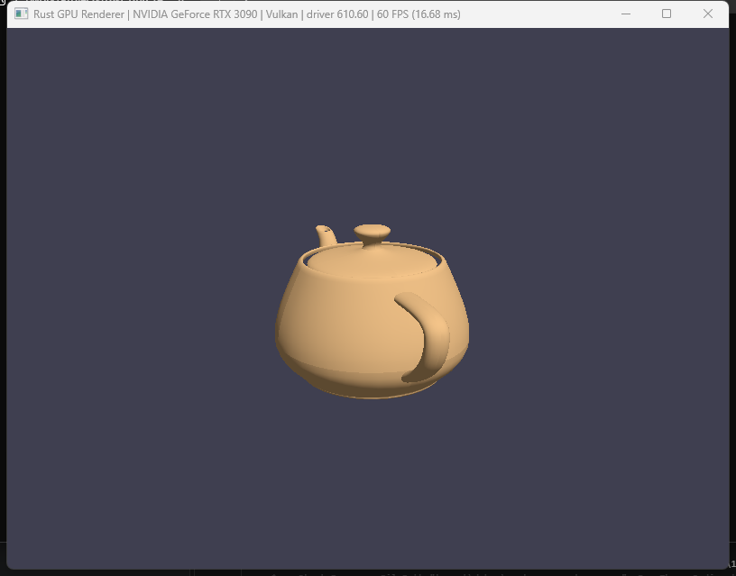

# Rust GPU Renderer

A small GPU renderer written in Rust, built step by step as a learning project.

## Demo



The Utah teapot (3,644 vertices, 6,320 triangles), loaded from an OBJ file with a hand-written reader. It spins around the y axis, with diffuse and ambient lighting. It runs at 60 FPS on an RTX 3090 with both the Vulkan and DX12 backends.

## Why this repo exists

I want to **learn Rust by comparing it with C++**. I don't just want to know the syntax. I want to understand why Rust works the way it does, and what it does better or worse than C++.

To make this real, I'm building something I know well. I worked in the game industry, where I focused on **graphics rendering**, and it is still what interests me most. Rendering is a good test for a language:

- It needs **speed**: per-frame work, tight loops, no garbage-collector pauses.
- It needs **careful memory handling**: GPU buffers, textures and objects that must outlive each other in the right order.
- It talks to **low-level C APIs** (Vulkan, DX12) that are easy to misuse.
- It gains from **multithreading**, which is where C++ code often gets data races.

These are the places where Rust claims to be better than C++, so this project lets me check those claims on a problem I already understand.

## How I'm comparing Rust with C++

While building, I pay attention to things like:

| Topic | C++ habit | What Rust does instead |
|---|---|---|
| Freeing resources | Destructors / RAII, raw pointers | Ownership and `Drop`. The compiler checks who owns what. |
| Object lifetimes | Remember the rules yourself | Lifetimes and `Arc`: a surface can't outlive its window. |
| Errors | Exceptions, error codes, null | `Result` and `Option`, which you must handle. |
| Threads | Locks and care | `Send` / `Sync`: data races become compile errors. |
| Unsafe code | Everything can be unsafe | Risky code sits in small, marked `unsafe` blocks. |
| Data for the GPU | `struct` + `memcpy` | `#[repr(C)]` + bytemuck `Pod`, checked at compile time. |
| Build and libraries | CMake, vcpkg/Conan, a test framework | One tool: `cargo` (build, deps, test, lint, format). |

I also write some things by hand that a library would normally do (the matrix math, the OBJ model reader), so I can see how they look in Rust.

## Plan

1. **wgpu** first: a safe, cross-platform Rust graphics API that runs on top of Vulkan, DX12 and Metal.
2. **Raw Vulkan** with `ash`: the same renderer, but with the low-level API, to see how Rust handles `unsafe` code.
3. **Raw DX12** with the `windows` crate.
4. After the second backend exists, put the backends behind one shared Rust trait.

Progress:

- [x] Triangle
- [x] Vertex and index buffers
- [x] Spinning 3D cube (hand-written `Mat4`, depth buffer)
- [x] Load a model from an OBJ file (Utah teapot) with diffuse lighting
- [ ] Raw Vulkan backend
- [ ] Raw DX12 backend

## What it does now

Opens a window and draws the Utah teapot spinning, lit by one directional light. The window title shows the GPU, the backend and the frame rate. Tested on Windows 11 with an RTX 3090, using both the Vulkan and DX12 backends.

## Build and run

You need [Rust](https://rustup.rs) (stable, edition 2024).

```sh
cargo run              # build and run
cargo test             # run the unit tests
cargo clippy           # lint
```

Pick a backend (PowerShell):

```powershell
$env:WGPU_BACKEND="vulkan"; cargo run
$env:WGPU_BACKEND="dx12"; cargo run
```

## Code layout

| File | What it does |
|---|---|
| `src/main.rs` | Creates the window and handles window events. |
| `src/renderer.rs` | All the wgpu code: setup, pipeline, buffers, drawing a frame. |
| `src/shader.wgsl` | Vertex and fragment shaders (WGSL). |
| `src/vertex.rs` | The `Vertex` struct and its GPU buffer layout. |
| `src/math.rs` | Hand-written `Vec3` and `Mat4`, with tests. |
| `src/obj.rs` | Hand-written OBJ model reader, with tests. |
| `assets/` | Model files. |
| `docs/CHANGELOG.md` | What changed, and when. |
